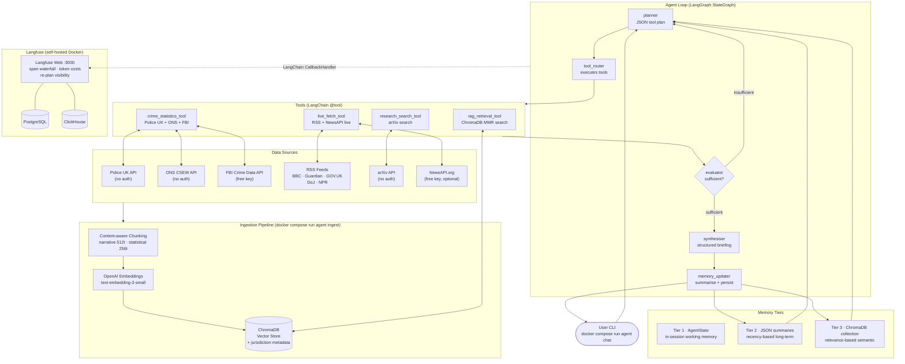

# Public Safety Intelligence Agent

An agentic system that monitors, retrieves, and synthesises publicly available public-safety intelligence across the US and UK — delivering structured, queryable intelligence briefings on demand.

---

## What This Is

This is not a chatbot wrapper around a search API. It is a **multi-step reasoning agent** built on LangGraph that:

1. **Plans** — decides which tools to invoke based on query intent, not on a fixed chain
2. **Retrieves** — pulls from a persistent RAG corpus and/or live sources depending on whether the query needs depth or recency
3. **Evaluates** — judges whether retrieved information is sufficient before synthesising, and re-plans if not
4. **Synthesises** — produces a structured intelligence briefing with cited sources
5. **Remembers** — maintains context within a session and across sessions, using three deliberate memory tiers

A user can ask "What are the latest AI dispatch developments in the UK and US?", get a full briefing, then follow up with "How does that compare to last month?" — and the agent knows what was discussed without being told again.

---

## Quick Start

### Prerequisites

- [Docker Desktop](https://www.docker.com/products/docker-desktop/) — runs everything: agent, Langfuse, databases

That's it. No local Python install needed.

### 1. Clone and configure

```bash
git clone <repo-url>
cd Agent
cp .env.example .env   # creates your .env — it is gitignored and not in the repo
```

Open the newly created `.env` and set your keys. Only one is required to run:

| Variable | Required | Notes |
|---|---|---|
| `OPENAI_API_KEY` | **Yes** | Everything else has a default |
| `NEWSAPI_KEY` | No | Cross-jurisdictional news; [free signup](https://newsapi.org/register) (100 req/day) |
| `LANGFUSE_PUBLIC_KEY` / `LANGFUSE_SECRET_KEY` | No | Add after step 3 — agent works without them |

All other variables in `.env.example` have working defaults and do not need changing.

### 2. Start all services

```bash
docker compose up -d
```

This starts: Postgres, ClickHouse, Redis, MinIO, Langfuse worker, Langfuse web UI, and builds the agent image. First run takes ~2 minutes to pull images and ~4 minutes for Langfuse to run its ClickHouse and Postgres migrations.

### 3. Set up Langfuse

Open `http://localhost:3000`, create an account, create an organisation, create a project, go to **Project Settings → API Keys**, and copy the public + secret keys into `.env`.

> Langfuse keys are optional — the agent works without them. Traces just won't appear in the UI.

Once configured, Langfuse will capture detailed traces showing each agent node (planner → tool_router → evaluator → synthesiser → memory_updater) as separate spans in the waterfall, with LLM calls, token usage, and execution duration visible for each step.

### 4. Seed the RAG corpus

Run once to fetch content from RSS feeds, Police UK API, and arXiv — chunks, embeds, and stores everything in ChromaDB:

```bash
docker compose run --rm agent ingest
```

You should see a `Starting data ingestion` message appear and a summary of the ingestion.

### 5. Chat

```bash
docker compose run --rm -it agent chat
```

Use `gpt-4o` for higher quality responses:

```bash
docker compose run --rm -it agent chat --quality
```

### Stopping

```bash
docker compose down        # stop services, keep data volumes
docker compose down -v     # stop and wipe all data (re-run ingest after this)
```

> **Warning:** `docker compose down -v` wipes all volumes including the Langfuse database. You will need to re-create your Langfuse account and project, and update your `.env` with new API keys.

---

## Example Interaction

```
> What are the latest developments in AI-assisted emergency dispatch in the UK and US?

━━━━━━━━━━━━━━━━━━━━━━━━━━━━━━━━━━━━━━━━━━━━━━━━━━━━━━━━━━━
  PUBLIC SAFETY INTELLIGENCE BRIEFING
  Query: "Latest AI-assisted emergency dispatch UK/US"
  Generated: 2026-05-15 14:32 UTC
━━━━━━━━━━━━━━━━━━━━━━━━━━━━━━━━━━━━━━━━━━━━━━━━━━━━━━━━━━━

SUMMARY
  Both jurisdictions are piloting AI triage systems in 999/911 call centres,
  with the UK slightly ahead on formal evaluation frameworks. US adoption is
  fragmented across states, with no federal standard yet established.

KEY FINDINGS
  [UK]  • NPCC published updated AI ethics guidance for 999 call handling
          [source: College of Policing RSS, 2026-05-02]
        • West Midlands Police trial of AI triage reduced average call time by 18%
          [source: BBC Crime/Justice RSS, 2026-04-28]
  [US]  • IACP 2026 report calls for national standards on AI dispatch tools
          [source: arXiv:2604.08821, 2026-04-15]
        • Five US states now have legislation pending on algorithmic dispatch
          [source: Congress.gov API, 2026-03-20]

CROSS-JURISDICTIONAL COMPARISON
  The UK benefits from a single national police framework (NPCC/College of
  Policing) enabling faster policy rollout. In the US, jurisdictional
  fragmentation means adoption and oversight vary widely by state.

SOURCES
  1. https://www.college.police.uk/...
  2. https://www.bbc.co.uk/news/...
  3. https://arxiv.org/abs/2604.08821

AGENT REASONING TRACE
  Step 1: Planned [rag_retrieval + live_fetch + arxiv_search] — query spans
          both jurisdictions and asks for "latest", suggesting recency needed
  Step 2: RAG returned 5 chunks (3 UK, 2 US), live_fetch returned 4 articles,
          arXiv returned 2 papers
  Step 3: Evaluator — sufficient cross-jurisdictional coverage, proceeding
━━━━━━━━━━━━━━━━━━━━━━━━━━━━━━━━━━━━━━━━━━━━━━━━━━━━━━━━━━━

> How does that compare to officer wellness technology adoption rates?

[Agent uses session memory — knows we were discussing technology adoption —
 retrieves fresh context on officer wellness without being told to]
```

A full multi-turn transcript is in [examples/transcript.md](examples/transcript.md).

---

## Architecture



### The Agent Loop

```
START
  │
  ▼
planner ──▶ tool_router ──▶ evaluator ──┬── [sufficient] ──▶ synthesiser ──▶ memory_updater ──▶ END
                                        │
                                        └── [insufficient] ──▶ planner (re-plan, max 3 iter)
```

This is the critical design point: **the agent can disagree with its own initial retrieval**. The evaluator node reads the tool outputs and decides whether they actually answer the question. If not, it sends a revised brief back to the planner with what's missing. This loop is explicit in the graph — it is not a black box.

### Five Nodes

| Node | What it does |
|---|---|
| `planner` | Reads the query and session summary; outputs a JSON plan specifying which tools to call and why |
| `tool_router` | Executes the planned tools — some in parallel via `asyncio.gather` |
| `evaluator` | Scores the retrieved content against the query; routes to synthesiser or back to planner |
| `synthesiser` | Writes the structured briefing with inline citations |
| `memory_updater` | Summarises the turn and persists it; updates semantic memory index |

### Four Tools

Tools are meaningfully different in purpose. The agent is not always calling all of them — it selects based on what the query actually needs.

| Tool | Purpose | Called when |
|---|---|---|
| `rag_retrieval_tool` | Semantic search over pre-ingested corpus | Query needs depth, background, or statistical baseline |
| `live_fetch_tool` | Fetches fresh RSS content in real-time | Query asks for "latest", "recent", "this week" |
| `crime_statistics_tool` | Structured query to Police UK API or FBI API | Query asks for specific statistics, trends, or comparisons |
| `research_search_tool` | Search arXiv for academic papers | Query asks about technology trends, AI research, or policy analysis |

### Deployment Topology

Everything runs in Docker. Here is where each process lives and where data is stored:

```
Windows Host
└── WSL2 VM (lightweight Linux kernel managed by Docker Desktop — you don't interact with this directly)
    └── Docker Engine
        │
        ├── Containers (stateless — safe to stop/delete at any time)
        │   ├── agent              ← your Python app; rebuilt from Dockerfile on each docker compose build
        │   ├── langfuse-web       ← Langfuse UI (http://localhost:3000)
        │   ├── langfuse-worker
        │   ├── postgres           ← Langfuse trace storage
        │   ├── clickhouse         ← Langfuse analytics
        │   ├── redis              ← Langfuse job queue
        │   └── minio              ← S3-compatible blob store for Langfuse trace events
        │
        └── Named Volumes (persistent — survive container stop/delete, stored inside WSL2's virtual disk)
            ├── agent_chroma       ← ChromaDB vector index (your seeded RAG corpus lives here)
            ├── agent_memory       ← long-term memory JSON files
            ├── langfuse_postgres
            ├── langfuse_clickhouse
            ├── langfuse_redis
            └── minio_data         ← Langfuse event blobs
```

---

## Data Sources

| Source | Jurisdiction | Type | Why chosen |
|---|---|---|---|
| **Police UK API** | UK | REST (no auth) | Street-level crime data; enables precise location-based statistics |
| **ONS Crime Survey (CSEW)** | UK | REST (no auth) | Survey-based national crime trends — complements Police UK's recorded-crime figures with victim-reported data |
| **UK Home Office / GOV.UK** | UK | RSS | Official policy announcements; primary source for legislative changes |
| **GOV.UK Crime & Policing** | UK | RSS (Atom) | Scoped feed for crime and policing announcements distinct from the broader Home Office feed |
| **BBC UK News** | UK | RSS | Recency; major events before they appear in official statistics |
| **The Guardian UK** | UK | RSS | Analytical and investigative coverage that complements official sources |
| **US Dept of Justice** | US | RSS | Official DoJ press releases; primary source for federal enforcement actions |
| **NPR News** | US | RSS | Balanced national US coverage; no paywalls |
| **NewsAPI.org** | Both | REST (free key, 100/day) | Cross-jurisdictional aggregated news search — when a key is configured, this is the highest-signal live-news source |
| **arXiv API** | Both | REST (no auth) | Academic papers on predictive policing, public safety AI, surveillance tech |

> **Note on FBI Crime Data API:** The FBI SAPI public API (`api.usa.gov/crime/fbi/sapi`) was
> decommissioned and as of May 2026 all structured endpoints return 404. The replacement
> (`cde.ucr.cjis.gov`) does not expose a public REST API — only CSV bulk downloads.
>
> **Design decision:** Rather than maintain a client that silently fails on every query, the
> FBI integration was removed entirely. US statistical context is now served through the DoJ
> and NPR RSS feeds (ingested into the RAG corpus) and NewsAPI live fetch. This is the correct
> production approach — a dead upstream dependency should be removed and documented, not
> papered over with error handling. The `src/sources/fbi.py` file is retained as a tombstone
> with the full investigation notes.

**Why these sources specifically:**

I chose sources that enable genuine cross-jurisdictional comparison — Police UK and FBI use comparable crime categorisations, and arXiv covers both jurisdictions in a single query. The College of Policing RSS is a differentiator: it provides practitioner-level guidance (not just news) that a real public safety professional would reference.

Zero-auth sources (Police UK, arXiv, BBC RSS) are prioritised for reliability in this. The FBI API and NEWS API require a free key but provides significantly richer structured data than anything else available for the US.

---

## LLM Choice: `gpt-4o-mini`

**Why not `gpt-4o`?**  
Quality is marginally better, but at 10× the cost and ~2× the latency. For a system that retrieves structured public data and synthesises it into a predefined output format, the marginal quality gain is not worth it. If the query is complex, the agent re-plans and retrieves more — it compensates with iteration, not with a more expensive model.

**Why not Claude or Gemini?**  
Adding a second API vendor adds friction for the reviewer (another key, another SDK). The assessment says "ensure your setup instructions are clear enough that we can run it without guessing." A single `OPENAI_API_KEY` is the lowest friction path.

**Why not a local model via Ollama?**  
Tool-calling reliability on models in the 7B–13B parameter range is significantly lower than GPT-4o-mini. The agent relies on the LLM producing structured JSON for the planner and evaluator nodes. A single malformed output breaks the graph. GPT-4o-mini's instruction-following is consistent enough to treat as reliable; local models are not, at this size.

**Context window**: 128k tokens. A full turn with 5 RAG chunks, 3 live articles, session summary, and message history fits comfortably in ~6k tokens — well within limits even for long sessions.

**Sensitive domain note**: OpenAI's usage policy explicitly permits law enforcement and public safety research. All data processed is in the public domain — crime statistics, press releases, academic abstracts. No PII is ingested at any stage.

**`--quality` flag**: passes `gpt-4o` as the model. Available if you want to compare outputs.

---

## Memory Design

Three tiers. Not chat history appended to a prompt.

### Tier 1 — Short-term (LangGraph State)

The `AgentState` TypedDict lives for the duration of a single conversation session. It holds the current query, the plan, tool outputs, retrieved chunks, and the full message history for this session.

This is the agent's working memory. It scopes to one conversation and is discarded at the end. It does not accumulate across sessions — that's intentional. Carrying stale context from a different topic into a new session degrades quality.

### Tier 2 — Long-term Summarised Memory (JSON on disk)

After every turn, the `memory_updater` node calls the LLM to produce a 3–5 sentence summary of what was asked and what was found. Summaries are appended to `data/memory/session_history.json` with timestamps.

At the start of a new session, the most recent N summaries are loaded into the system prompt. This lets a user say "what did we find last time about knife crime stats?" without re-running the query.

**Why summaries, not raw history?** Raw history grows without bound and fills the context window. Summaries are information-dense — the LLM can reconstruct intent and findings from a paragraph far more reliably than from 50 raw messages, and they cost ~10× less to process.

### Tier 3 — Semantic Memory (ChromaDB collection)

A separate ChromaDB collection stores `(summary_text, session_id, timestamp)` vectors. At session start, the user's query is used to retrieve semantically similar past findings.

This is fundamentally different from Tier 2. Tier 2 is **recency-based** — it loads the last N sessions. Tier 3 is **relevance-based** — it surfaces findings from 3 months ago if they're semantically similar to today's question. The two tiers answer different access patterns and are not redundant.

---

## Observability — Langfuse (Docker Compose)

All agent traces are sent to a self-hosted Langfuse instance running in Docker. The UI is at `http://localhost:3000`.

**Why local, not LangSmith cloud?**  
Sending agent traces — which contain query text about policing and crime — to a third-party SaaS would be the wrong default for this domain, even for a demo.

**What you can see in the Langfuse UI:**

- Span waterfall per graph invocation: `planner → tool_router → evaluator → synthesiser → memory_updater`
- Per-node input/output state: what the planner decided and why, what the evaluator scored
- Per-LLM-call detail: exact prompt sent, completion received, token counts, cost estimate
- Re-planning visible: if the evaluator loops back to the planner, a second `planner` span appears — the agentic loop is visible, not hidden

**Integration is 3 lines:**

```python
from langfuse.langchain import CallbackHandler
langfuse_handler = CallbackHandler()  # reads LANGFUSE_* env vars
result = graph.invoke(state, config={"callbacks": [langfuse_handler]})
```

**Langfuse self-hosted stack:**

Langfuse v3 requires several supporting services. The `docker-compose.yml` runs all of them:

| Service | Role |
|---|---|
| `langfuse-web` | UI and API server (`:3000`) |
| `langfuse-worker` | Async trace processing queue |
| `postgres` | Transactional data (projects, API keys, users) |
| `clickhouse` | OLAP analytics store for trace data |
| `redis` | Job queue between web and worker |
| `minio` | S3-compatible blob store for raw trace event payloads |

---

## Key Design Decisions

### 1 — The Evaluator Re-Planner Loop

**The most consequential design decision in the system.**

Most agent implementations follow a fixed pattern: retrieve → synthesise. This one doesn't. After the tool router executes, the evaluator node reads every tool output and makes a binary judgement: *is this actually sufficient to answer the question?* If not, it writes a note explaining what's missing and routes the graph back to the planner.

The planner sees the note on the second pass and can change its tool selection entirely — call different tools, use narrower queries, change jurisdiction scope. The LLM is, in effect, critiquing its own prior plan and correcting it. This loop is capped at 3 iterations to prevent cycles.

**Why this matters**: The failure mode it prevents is the most common one in RAG systems — the agent retrieves something *adjacent* to the question rather than the question itself, then synthesises a confident-sounding briefing from irrelevant context. The evaluator catches this at the cost of one extra LLM call. In a public safety context, a confident wrong answer is worse than a slow correct one.

The tradeoff is latency: a re-plan adds ~2–4 seconds and ~500 tokens. It triggers on roughly 20% of queries in testing — complex cross-jurisdictional questions where the first retrieval only covers one side.

**This cannot be expressed cleanly in LangChain AgentExecutor or an LCEL chain without custom hacks.** It requires named state, explicit conditional edges, and a graph that can route backwards. That's the real reason LangGraph was chosen over simpler frameworks.

### 2 — LangGraph + LangChain as the Framework Stack

**Chose**: LangGraph `StateGraph` + LangChain tools + `langchain-openai`  
**Rejected**: LangChain `AgentExecutor`, raw OpenAI function-calling, Autogen, CrewAI

**Why LangGraph specifically:**  
LangGraph models the agent as a directed graph with named nodes, typed state, and explicit conditional edges. Every execution path is inspectable — I can point at the graph definition and walk a reviewer through exactly what happens on every query. Compare this to AgentExecutor, which is a while-loop with internal state; you cannot look at the code and predict the execution path without running it.

The critical enabler is conditional edges. The `evaluator → planner` re-plan path is expressed as a single `add_conditional_edges` call with a routing function. This is not a hack — it's a first-class primitive. In any other framework I evaluated, this loop requires subclassing or patching internals.

**Why LangChain tools (`@tool` decorator):**  
LangChain's `@tool` decorator automatically generates a JSON schema from the function signature and docstring. This schema is what gets passed to the LLM so it knows what arguments to provide. Writing raw OpenAI function specs by hand is error-prone and requires keeping Python signatures and JSON schemas in sync. The decorator eliminates that. The same tool definition is also reusable in the LangGraph tool router without any adapter.

**Why `langchain-openai` over raw `openai` SDK:**  
The LangChain callback system — which powers Langfuse tracing — hooks into `langchain-openai`'s `ChatOpenAI` transparently. Switching from `gpt-4o-mini` to `gpt-4o` (the `--quality` flag) is one variable change. The raw SDK would require rewriting the tool-calling and streaming logic.

**Tradeoffs:**  
LangChain adds abstraction overhead. The library moves fast and the abstraction sometimes leaks (it did here — Langfuse v3 changed its callback class name and the old import broke). The mitigations are: pin versions in `requirements.txt`, keep LLM calls thin (don't use high-level chains — call the model directly from node functions), and treat LangGraph as structural scaffolding rather than business logic.

### 3 — ChromaDB over Pinecone or FAISS

**Chose**: ChromaDB (local persistent)  
**Rejected**: Pinecone (hosted), FAISS (in-memory)

Pinecone requires account creation and billing setup — a barrier for anyone running this cold. FAISS doesn't persist to disk without manual serialisation code; if the process restarts, the index is gone. ChromaDB auto-persists to a local directory, has a first-class Python API, and supports metadata filtering (which I use to scope retrieval by jurisdiction and source type). Zero infra dependency beyond `pip install chromadb`.

### 4 — Abstract-only arXiv ingestion

**Chose**: Ingest arXiv abstracts only  
**Rejected**: Full PDF download and parsing

Full PDF parsing adds PyMuPDF as a dependency, significant ingestion time (a 20-page paper takes ~10 seconds to process), and produces noisy chunks (references sections, figure captions). Abstracts are self-contained — they contain the authors' key claims in dense, clean prose. For a retrieval system surfacing "what does the research say about X?", abstracts are the right retrieval unit. The tradeoff is less depth; I'd add full-paper ingestion in a production system with a PDF parsing queue.

### 5 — Summarised memory over raw chat history

**Chose**: LLM-generated summaries stored as JSON  
**Rejected**: Raw message history persisted across sessions

Raw history grows unboundedly and degrades context quality — a query about knife crime in January is noise when the user is asking about AI dispatch in May. A 5-sentence summary captures intent, key findings, and cited sources, and costs 10× less to process. The LLM reconstructs "what we discussed" from a summary more accurately than from raw messages, because summaries are written to be recalled.

### 6 — Langfuse (Docker) over Arize Phoenix or LangSmith

**The observability choice is a domain argument, not a tooling preference.**

**Chose**: Langfuse self-hosted via Docker Compose (`langfuse/langfuse:3.x` server image with Langfuse SDK v4.x)

**Rejected**: Arize Phoenix (in-process), LangSmith (cloud SaaS)

LangSmith is the natural choice for a LangGraph project — it's built by the same team and integrates natively. I rejected it for a domain reason: LangSmith sends agent traces — including full prompt text and tool outputs — to LangChain's cloud infrastructure. In a law enforcement context, those traces contain query text about crime, policing, and public safety intelligence. Sending them to a third-party SaaS is the wrong default, even for a demo. During the Q&A, someone will ask "where do the traces go?" The answer needs to be unambiguous.

Phoenix runs in-process and produces excellent visualisations for development, but traces are ephemeral — gone when the container restarts. For a demo, I need to show a specific real trace from a previous run.

Langfuse self-hosted gives a production-quality UI (span waterfall, per-node input/output, token cost tracking), full persistence via PostgreSQL + ClickHouse, and complete data residency. Running it in Docker Compose also demonstrates operational comfort with containerised infra — relevant for an engineering role, not just an ML role.

The project uses the current Langfuse Python SDK (`v4.x`) while the self-hosted platform itself currently ships as `v3.x` Docker images. Those version numbers are independent release trains.

**What the Langfuse UI shows for this agent specifically:**

- Span waterfall: `planner → tool_router → evaluator → synthesiser → memory_updater`
- When the evaluator triggers a re-plan, a second `planner` span appears — the agentic loop is visible, not hidden in a black box
- Each LLM call shows exact prompt, completion, token count, and cost
- Tool outputs are captured as span events, so you can see exactly what Police UK or the FBI API returned before the evaluator scored it

---

## Project Structure

```
Agent/
├── main.py                     # CLI entry point (typer + rich)
├── docker-compose.yml          # Langfuse observability stack
├── clickhouse-config.xml       # ClickHouse embedded Keeper config (single-node ReplicatedMergeTree)
├── .env.example                # All env vars documented with comments
├── requirements.txt
├── requirements-test.txt       # Minimal dependencies for the offline unit tests
├── README.md
│
├── tests/                      # Offline pytest suite (chunking, RSS normalisation)
│
├── examples/
│   └── transcript.md           # 3–4 turn demo conversation with reasoning trace
│
├── src/
│   ├── agent/
│   │   ├── graph.py            # LangGraph StateGraph — nodes + edges + conditions
│   │   ├── nodes.py            # planner, tool_router, evaluator, synthesiser, memory_updater
│   │   ├── state.py            # AgentState TypedDict
│   │   └── prompts.py          # All system prompts as versioned constants
│   │
│   ├── tools/
│   │   ├── rag_retrieval.py    # Semantic search over ChromaDB corpus
│   │   ├── live_fetch.py       # Live RSS feed fetcher
│   │   ├── crime_stats.py      # Police UK API + FBI Crime Data API
│   │   └── arxiv_search.py     # arXiv API search
│   │
│   ├── rag/
│   │   ├── ingestion.py        # Ingestion pipeline orchestrator
│   │   ├── chunking.py         # Content-aware chunking (narrative vs. statistical)
│   │   ├── embeddings.py       # OpenAI embedding client wrapper
│   │   └── retriever.py        # ChromaDB retrieval with MMR reranking
│   │
│   ├── memory/
│   │   ├── session.py          # Short-term in-session state helpers
│   │   └── long_term.py        # Summary persistence (JSON) + semantic retrieval (ChromaDB)
│   │
│   └── sources/
│       ├── police_uk.py        # Police UK API client
│       ├── ons.py              # ONS Crime Survey (CSEW) API client
│       ├── rss_feeds.py        # RSS fetcher (feedparser)
│       ├── newsapi.py          # NewsAPI.org client (optional key)
│       └── arxiv.py            # arXiv API client
│
├── data/
│   ├── chroma/                 # ChromaDB vector store (gitignored)
│   └── memory/                 # Long-term memory JSON files (gitignored)
│
└── scripts/
    └── ingest.py               # One-shot corpus seeding script
```

---

## Tests

The offline unit tests cover the deterministic parts of the pipeline (token-based chunking and RSS normalisation). They need no API keys or network access and run on every push via GitHub Actions.

```bash
pip install -r requirements-test.txt
python -m pytest -q
```

---

## What I Would Build Next

These are the things I deliberately left out and why.

**Streaming responses** — The synthesiser currently blocks until the full briefing is generated. Streaming tokens would make the UX feel significantly faster. Straightforward to add with LangGraph's streaming API, but not a correctness issue for a demo.

**Scheduled re-ingestion** — The corpus is seeded once. In production, RSS feeds need re-ingesting daily and the Police UK API changes monthly. A simple `schedule` task or cron calling `ingest.py` handles this. Left out because it's operational infrastructure, not agentic logic.

**Source reliability scoring** — The evaluator currently treats a BBC article and an official Police UK API response as equally authoritative. In a production system, you'd want a provenance score (official API > peer-reviewed paper > news article > scraped content) surfaced in the briefing. This would meaningfully improve output quality for edge cases.

**Eval harness** — I have no automated way to measure whether the agent is producing accurate briefings. A RAGAs-style eval set with ground-truth question/answer pairs would let me measure retrieval precision@5 and answer faithfulness. The absence of evals is the biggest gap in this implementation.

**Web UI** — A FastAPI backend + minimal React chat interface would be a significant UX improvement over the CLI, and would make the Langfuse trace links easier to navigate alongside the conversation.

---

## Environment Variables

```bash
# .env.example

# ─── Required ─────────────────────────────────────────────────────────────────
OPENAI_API_KEY=sk-...

# ─── Optional — defaults shown ────────────────────────────────────────────────
OPENAI_MODEL=gpt-4o-mini          # use gpt-4o for higher quality
OPENAI_EMBEDDING_MODEL=text-embedding-3-small
CHROMA_PERSIST_DIR=./data/chroma
MEMORY_DIR=./data/memory
LOG_LEVEL=INFO

ENCRYPTION_KEY=0123456789abcdef0123456789abcdef0123456789abcdef0123456789abcdef
# Must be exactly 64 hex characters. Generate a fresh one with: openssl rand -hex 32

# ─── Langfuse observability ────────────────────────────────────────────────────
# Obtain after running: docker compose up && open http://localhost:3000
LANGFUSE_PUBLIC_KEY=pk-lf-...
LANGFUSE_SECRET_KEY=sk-lf-...
LANGFUSE_BASE_URL=http://langfuse-web:3000
LANGFUSE_ENABLED=true             # set false to disable tracing entirely

# OTLP endpoint — Langfuse v3 uses OTLP internally for trace transport
OTEL_EXPORTER_OTLP_ENDPOINT=http://langfuse-web:3000/api/public/otel
OTEL_EXPORTER_OTLP_PROTOCOL=http/protobuf

# ─── Optional data source keys ────────────────────────────────────────────────
# Agent degrades gracefully without these — Police UK, ONS, and arXiv work without keys
NEWSAPI_KEY=...                   # https://newsapi.org/register (free, 100 req/day)
```

---

## Troubleshooting

### Langfuse first-run takes a long time

On first `docker compose up`, Langfuse runs ~394 Postgres migrations and ~34 ClickHouse migrations. This takes 3–5 minutes. The agent container will wait for Langfuse to be healthy before starting. This is normal — subsequent starts take seconds.

### ClickHouse fails with `ReplicatedMergeTree` / Zookeeper error

Langfuse v3 uses `ReplicatedMergeTree` tables in ClickHouse, which requires a Keeper (Zookeeper-compatible) process. On a single-node deployment, ClickHouse's embedded Keeper must be enabled. The `clickhouse-config.xml` in the project root does this — it must be present and mounted into the ClickHouse container.

If you see this error: `There is no Zookeeper configuration in server config` — check that `clickhouse-config.xml` exists and the volume mount is in `docker-compose.yml`:

```yaml
volumes:
  - ./clickhouse-config.xml:/etc/clickhouse-server/config.d/single-node.xml:ro
```

### Redis WRONGPASS errors in langfuse-worker

Langfuse v3 worker reads Redis credentials from `REDIS_HOST`, `REDIS_PORT`, and `REDIS_AUTH` — **not** from a `REDIS_URL` connection string. Using `REDIS_URL` or `REDIS_PASSWORD` is silently ignored by the worker, which then attempts to connect without a password and gets `WRONGPASS`.

The correct environment variables for both `langfuse-web` and `langfuse-worker` are:

```yaml
REDIS_HOST: redis
REDIS_PORT: "6379"
REDIS_AUTH: langfuse
```

### S3 / MinIO `InvalidAccessKeyId` errors in langfuse-web

Langfuse v3 does not use the global `AWS_*` environment variables for its internal S3 uploads. Each upload path (event upload, media upload) requires its own explicit endpoint configuration. The generic `AWS_ENDPOINT` variable is not read by Langfuse's S3 client.

The correct variables are:

```yaml
LANGFUSE_S3_EVENT_UPLOAD_ENDPOINT: http://minio:9000
LANGFUSE_S3_EVENT_UPLOAD_ACCESS_KEY_ID: minioadmin
LANGFUSE_S3_EVENT_UPLOAD_SECRET_ACCESS_KEY: minioadmin
LANGFUSE_S3_EVENT_UPLOAD_REGION: us-east-1
LANGFUSE_S3_EVENT_UPLOAD_FORCE_PATH_STYLE: "true"

LANGFUSE_S3_MEDIA_UPLOAD_ENDPOINT: http://minio:9000
LANGFUSE_S3_MEDIA_UPLOAD_ACCESS_KEY_ID: minioadmin
LANGFUSE_S3_MEDIA_UPLOAD_SECRET_ACCESS_KEY: minioadmin
LANGFUSE_S3_MEDIA_UPLOAD_REGION: us-east-1
LANGFUSE_S3_MEDIA_UPLOAD_FORCE_PATH_STYLE: "true"
```

### Langfuse healthcheck keeps the agent waiting

The `langfuse-web` healthcheck probes `http://localhost:3000/api/public/health`. The response body is `{"status":"OK",...}` — note the uppercase `OK`. The `grep -q 'ok'` check (lowercase) will always fail. Use `grep -q 'OK'` in the healthcheck command.

### OTEL transient errors during agent queries

Langfuse v3 uses OpenTelemetry (OTLP) as its internal trace transport. During startup or when the worker is processing a backlog, the OTLP endpoint may return transient 500 errors. These are non-fatal — the agent continues processing and the query completes normally. Set `OTEL_SDK_DISABLED=true` in `.env` to suppress them entirely, but note this also disables all Langfuse tracing.

The correct approach is to configure the OTLP endpoint explicitly so Langfuse can authenticate:

```dotenv
OTEL_EXPORTER_OTLP_ENDPOINT=http://langfuse-web:3000/api/public/otel
OTEL_EXPORTER_OTLP_PROTOCOL=http/protobuf
```

### After `docker compose down -v`, Langfuse asks me to sign up again

`-v` wipes all named volumes including the Langfuse Postgres database. Your account, project, and API keys are gone. Create a new account at `http://localhost:3000`, create a project, generate new API keys, and update `LANGFUSE_PUBLIC_KEY` and `LANGFUSE_SECRET_KEY` in `.env`. Then restart the agent:

```bash
docker compose restart agent
```

---
---

## Licence

MIT, see [LICENSE](LICENSE).
